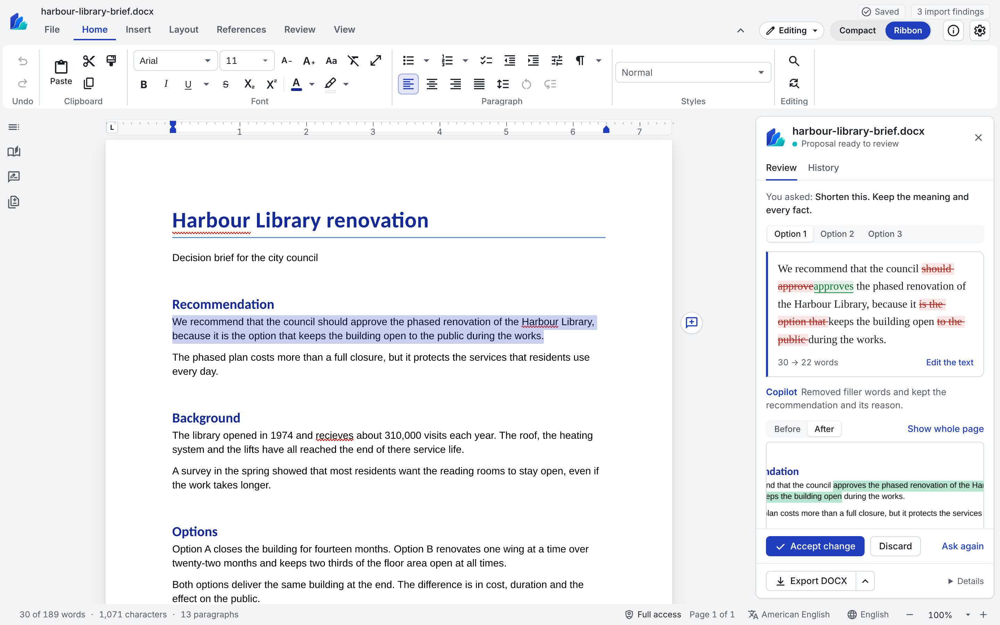
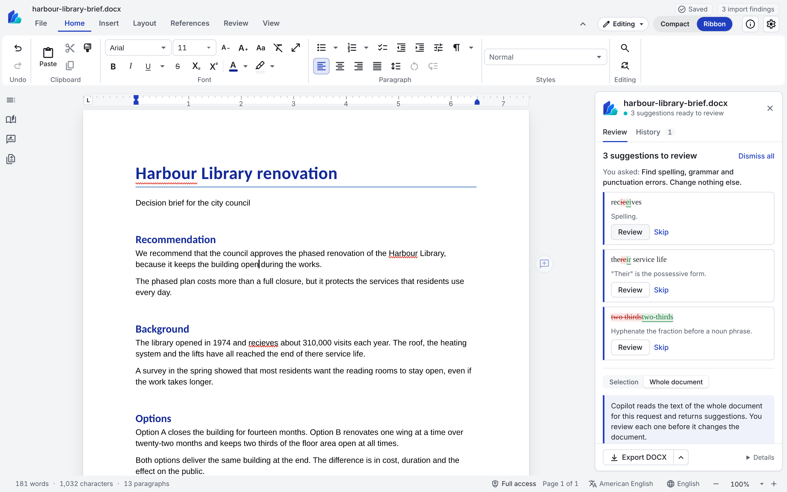
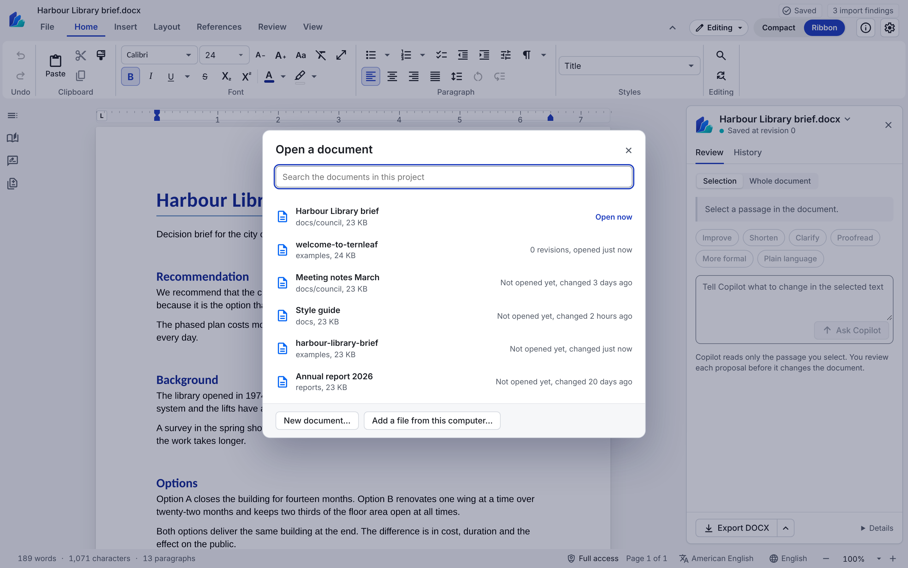

<p align="center">
  
</p>

<h1 align="center">Ternleaf</h1>

<p align="center">
  A document canvas for GitHub Copilot.<br>
  Write Word documents with a reviewer that knows your standards, measures the real page and keeps the reasons.
</p>



Ternleaf opens a local DOCX in a Copilot canvas with a real page layout. You select a passage, share the whole document or ask in the chat. Copilot proposes changes, and you accept, edit or discard each one. Copilot cannot change the document. Only your acceptance does.

A word processor helps you type a document. It does not know what the document is for. Ternleaf does three things that a word processor does not do:

- **It reviews against your standards.** Your team's rules are in a file in the project. Copilot follows them, and Ternleaf checks some of them itself while you write.
- **It measures before it proposes.** "Fit this to two pages" is tried on a copy of the document, with the real page count, before you see a suggestion.
- **It keeps the reasons.** Every accepted change has its request, Copilot's reason and your note. One file gives them to a reviewer who was not there.

> **Status: early release.** Ternleaf works end to end on a bounded set of documents and edits. Read [What works today](#what-works-today) before you use it for real work.

## What you can do

### Ask in place

Select text and a bubble appears below it. Choose **Shorten**, **Clarify** or **Proofread**, or write your own instruction.


### Review before anything changes

Each proposal shows the changed words, Copilot's reason, and the page before and after. Copilot can offer up to three options. You can edit the text yourself before you accept it, and add an edition note that is saved with the revision.

A proposal can replace a few words, rewrite a paragraph, add new paragraphs or remove a paragraph. New text keeps the formatting of the text that it replaces.

### Review the whole document

Choose **Whole document** and a review such as **Proofread** or **Check consistency**. Ternleaf sends the document text for that one request. Copilot returns a list of suggestions, and you step through them.



### Ask in the chat

You can also type in the Copilot chat: "Proofread the document", "Make the selected sentence shorter", "Is the chart on page 2 easy to read?" or "Give me a PDF". Copilot reads the current text through the canvas, looks at a page when it must see the layout, and puts its proposals in the Review pane with the label **From the chat**. A notice in the canvas tells you each time Copilot reads the document.

### Review against your own standards


Put your team's writing rules in `ternleaf.rules.md` in the project folder. Copilot follows them in every proposal and checks each document against them. Where new text solves a problem, it suggests the change. Where it cannot, it leaves a remark: "This number has no source", "These two paragraphs disagree", "This action has no owner". **Add as comment** keeps a remark in the document as a Word comment.

Some rules need no model. Write `max-pages: 2` or `avoid: utilize => use` in the rules file, and the Review pane shows the checks that fail while you write.

### Fit to a length, measured

Ask "Fit this to two pages". Copilot tries its cuts on a copy of the document, and the engine counts the real pages before you see a single suggestion. No smaller font, no narrower margin.

### Keep the reasons

**Download the change record** in the History tab writes one Markdown file with every change that you accepted: the request, Copilot's reason, the text before and after, and your note. A reviewer or an approver can read why the document says what it says.

### Go to Word and come back

Export a Word file, let a colleague edit it in Word, and choose **Merge a copy from Word**. Ternleaf knows which revision it exported, so it shows only what changed in Word, as suggestions in the same review. What you changed here in the meantime stays.

If your reviewer works with tracked changes, switch the editor to Suggesting. Each proposal that you accept then goes into the document as a Word tracked change.

### One source, several readers

A two-page brief of a long paper says what the paper says, for another reader. Choose **Make this an edition of…** and name the paper as the reference. When the paper changes, the brief shows you the passages that changed, and **Ask Copilot to update** brings proposals for the brief to the same review. You decide when the brief is checked.

### Open, create and add documents

Press Ctrl+O, or choose **File → Open**, to see the Word documents in the project folder. Start a new document from a blank page, a letter, a report or meeting notes, or add a copy of a file from your computer. Each document keeps its own history, and a new canvas returns to the document that you had open last.



### Keep a history

Every edit and every accepted proposal is a saved revision. The History tab shows what you asked, what changed and your note.


### Work in a narrow canvas, in light or dark

The pane docks beside the page when there is room and slides over it when there is not.

<p align="center">
  
</p>

## How it works

```
GitHub Copilot app
 ├─ chat session ◄──── session.send ───── Ternleaf extension (Node)
 │      │                                   ├─ canvas actions: read, propose, suggest, view page,
 │      └─ invoke_canvas_action ──────────► │                  export, open, history, status, guide
 │                                          ├─ hooks: canvas state with each prompt, guard on file tools
 │                                          ├─ loopback host: token-protected, 127.0.0.1 only
 └─ canvas (webview) ◄── HTTP ─────────────►│   └─ session store: SQLite journal per document
        └─ OpenDoc engine (Rust/WASM) + Ternleaf review pane
```

- **The editor** is [OpenDoc](https://github.com/CasualOffice/opendoc), a Rust/WebAssembly document engine, with a maintained [patch](engine/opendoc.patch). It runs in the canvas. Ternleaf adds the review pane, the selection bubble and the launcher.
- **The host** is a small Node server on the loopback interface. It serves the editor, knows the documents of the project folder, holds the open document's SQLite project file and publishes each revision in one transaction.
- **The extension** registers the canvas, its actions and two hooks with Copilot. A skill with the same guide is in `.github/skills/ternleaf`. When you send a request from the canvas, it posts a short prompt to your chat session. With each chat prompt it tells Copilot what the canvas shows.

| Action | What Copilot can do with it |
| --- | --- |
| `ternleaf_guide`, `ternleaf_status` | Learn how to work with the canvas, and what it shows now. |
| `ternleaf_read` | Read what you shared for a request, or the current text for a chat request. |
| `ternleaf_propose` | Offer a replacement for a passage, with a reason and up to two alternatives. |
| `ternleaf_suggest` | Offer a list of changes across the document, and remarks where no new text can help. |
| `ternleaf_decline` | Say that nothing needs to change, or that the answer is in the chat. |
| `ternleaf_view_page` | Look at a page as a picture: layout, tables, charts. |
| `ternleaf_measure` | Get the real pages and words of the document with a list of changes, before it suggests them. |
| `ternleaf_export` | Write the current revision as a Word file, PDF, Markdown, web page or text into `exports/`. |
| `ternleaf_reference_changes` | For an edition: read what changed in its reference document. |
| `ternleaf_documents`, `ternleaf_open_document` | List the Word documents of the project and show one. |
| `ternleaf_history` | Read the changes that you accepted. |

No action can edit the document. [Copilot's side of Ternleaf](docs/Agent.md) describes the actions, the hooks and what keeps Copilot from working around the canvas.

## What Copilot can see

- Copilot reads the document for you: the passage or the text that you share from the canvas, or the text that it needs for a request in the chat.
- A notice in the canvas tells you each time Copilot reads the text or the selection, looks at a page or exports a file.
- To keep Copilot to what you share from the canvas, set `"chat": false` in `.ternleaf/canvas.json`.
- A share from the canvas is for one request. It stops being readable when you discard it, reload the canvas or change the document.
- The document, its history and its fonts stay on your computer. The host listens on `127.0.0.1` with a new token for each canvas.
- Text that you share goes to the model through your Copilot session, under your Copilot terms.

## Get started

You need the GitHub Copilot desktop app with canvas extensions, and Git. The repository includes a prebuilt engine, so there is nothing to build.

1. Clone this repository.
2. Open the folder in the Copilot app and start a session.
3. Choose **+ → Canvas → Ternleaf**, or ask Copilot to "open the Ternleaf canvas".

The canvas opens [`examples/welcome-to-ternleaf.docx`](examples/welcome-to-ternleaf.docx), a short introduction with three exercises. [`examples/harbour-library-brief.docx`](examples/harbour-library-brief.docx) is the document in the pictures above.

To work on your own documents, put them in the project folder and press Ctrl+O, or ask Copilot to open one, for example "open docs/brief.docx in the Ternleaf canvas". Each document gets its own project file in `.ternleaf/`, and the original file is never changed.

[Install and run Ternleaf](docs/Install.md) covers fonts, configuration and troubleshooting.

| Shortcut | Action |
| --- | --- |
| Ctrl+O | Open another document |
| Ctrl+Shift+Space | Open the Review pane for the selection |
| Ctrl+Enter | Send the instruction |
| `/ternleaf` in the chat | Start a request with the Ternleaf skill, for example `/ternleaf open docs/brief.docx` |

## What works today

Ternleaf is strict about what it changes, because an edited DOCX must still open correctly in Word.

- One document is open in one canvas at a time.
- A proposal starts inside one paragraph. It can add paragraphs and remove a whole paragraph, but it cannot join two paragraphs. A change across bold and plain text gets the formatting of the first replaced word, and the review warns you. A change cannot touch a link, a tab or a line break.
- Export refuses to write a DOCX if the engine reports that source content would be lost. For one known, small loss it asks you first. PDF, Markdown, web page and plain text export always work.
- The canvas API of the Copilot SDK is experimental and can change.
- Ternleaf was developed and tested on Windows.

[Word fidelity](docs/Word-Fidelity.md) has the measurements against Microsoft Word. The [roadmap](docs/Roadmap.md) has the plan, what is done and what is open.

## Documentation

| Document | Contents |
| --- | --- |
| [Install and run](docs/Install.md) | Setup, your own documents, fonts and daily use |
| [Architecture](docs/Architecture.md) | The parts, the single writer and the path from request to revision |
| [Copilot's side](docs/Agent.md) | The actions, the context that Copilot gets and what the author sees |
| [The document engine](docs/Engine.md) | OpenDoc, the patch, the prebuilt engine and how to build it |
| [Word fidelity](docs/Word-Fidelity.md) | What is verified against Word and how to measure it |
| [Development](docs/Development.md) | Repository layout, tests and packaging |
| [Roadmap](docs/Roadmap.md) | Principles, the plan, what is done and what is open |

## Develop

```powershell
npm test
```

The unit tests need only Node.js 24. [Development](docs/Development.md) describes the browser test, the Word comparisons and how to package a bundle.

## Contribute

Issues and pull requests are welcome. Read [CONTRIBUTING.md](CONTRIBUTING.md) first. Report a security problem as described in [SECURITY.md](SECURITY.md).

## Licence

Ternleaf is licensed under the [Apache License 2.0](LICENSE). The prebuilt engine in [`engine/prebuilt`](engine/prebuilt) is a build of [OpenDoc](https://github.com/CasualOffice/opendoc) with the Ternleaf patch. OpenDoc, its dependencies and its fonts keep their own licences. Their notices are in [`engine/prebuilt/notices`](engine/prebuilt/notices).

Ternleaf is an independent project. It is not affiliated with or endorsed by GitHub or Microsoft. GitHub Copilot and Microsoft Word are trademarks of their owners.
