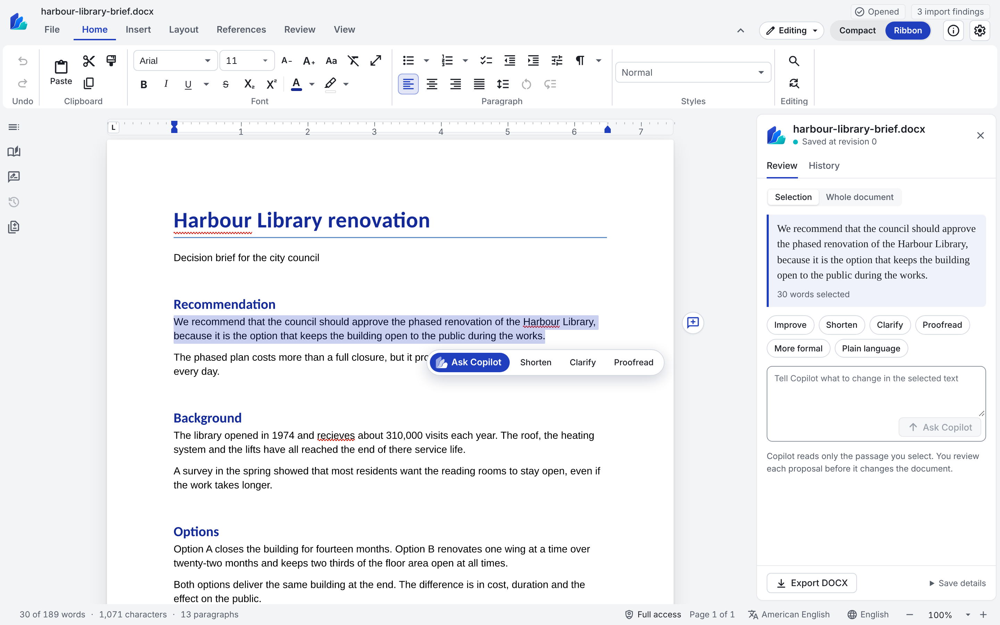
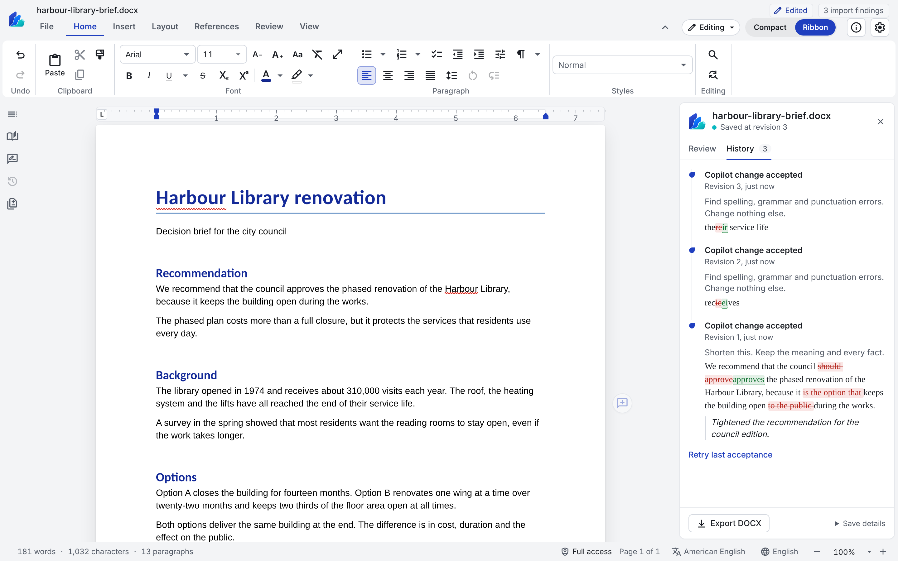
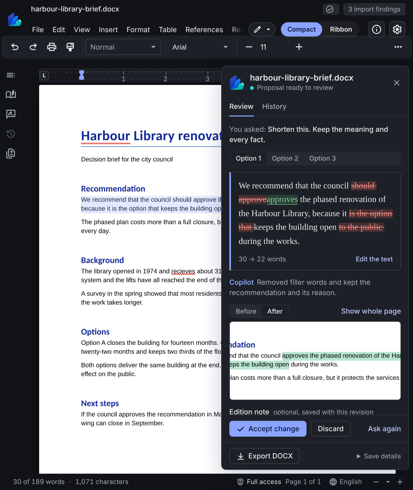

<p align="center">
  
</p>

<h1 align="center">Ternleaf</h1>

<p align="center">
  A document canvas for GitHub Copilot.<br>
  Write and revise Word documents, and review each Copilot proposal before it changes the page.
</p>


Ternleaf opens a local DOCX in a Copilot canvas with a real page layout. You select a passage or share the whole document, Copilot proposes changes, and you accept, edit or discard each one. Copilot cannot change the document. Only your acceptance does.

> **Status: early release.** Ternleaf works end to end on a bounded set of documents and edits. Read [What works today](#what-works-today) before you use it for real work.

## What you can do

### Ask in place

Select text and a bubble appears below it. Choose **Shorten**, **Clarify** or **Proofread**, or write your own instruction.



### Review before anything changes

Each proposal shows the changed words, Copilot's reason, and the page before and after. Copilot can offer up to three options. You can edit the text yourself before you accept it, and add an edition note that is saved with the revision.

### Review the whole document

Choose **Whole document** and a review such as **Proofread** or **Check consistency**. Ternleaf sends the document text for that one request. Copilot returns a list of suggestions, and you step through them.


### Keep a history

Every edit and every accepted proposal is a saved revision. The History tab shows what you asked, what changed and your note.



### Work in a narrow canvas, in light or dark

The pane docks beside the page when there is room and slides over it when there is not.

<p align="center">
  
</p>

## How it works

```
GitHub Copilot app
 ├─ chat session ◄──── session.send ───── Ternleaf extension (Node)
 │      │                                   ├─ canvas actions: ternleaf_read, ternleaf_propose,
 │      └─ invoke_canvas_action ──────────► │                  ternleaf_suggest, ternleaf_decline
 │                                          ├─ loopback host: token-protected, 127.0.0.1 only
 └─ canvas (webview) ◄── HTTP ─────────────►│   └─ session store: SQLite journal per document
        └─ OpenDoc engine (Rust/WASM) + Ternleaf review pane
```

- **The editor** is [OpenDoc](https://github.com/CasualOffice/opendoc), a Rust/WebAssembly document engine, with a maintained [patch](engine/opendoc.patch). It runs in the canvas. Ternleaf adds the review pane, the selection bubble and the launcher.
- **The host** is a small Node server on the loopback interface. It serves the editor, holds the document's SQLite project file and publishes each revision in one transaction.
- **The extension** registers the canvas and four actions with Copilot. When you send a request, it posts a short prompt to your chat session. Copilot reads what you shared through `ternleaf_read` and answers through the other actions.

| Action | What Copilot can do with it |
| --- | --- |
| `ternleaf_read` | Read the passage or the document text that you shared for one request. |
| `ternleaf_propose` | Offer a replacement for the shared passage, with a reason and up to two alternatives. |
| `ternleaf_suggest` | Offer a list of changes for a whole-document request. |
| `ternleaf_decline` | Say that nothing needs to change, or that the answer is in the chat. |

No action can edit the document.

## What Copilot can see

- Copilot reads only what you share: the selected passage, or the document text when you start a whole-document review.
- Each share is for one request. A request stops being readable when you discard it, reload the canvas or change the document.
- The document, its history and its fonts stay on your computer. The host listens on `127.0.0.1` with a new token for each canvas.
- Text that you share goes to the model through your Copilot session, under your Copilot terms.

## Get started

You need the GitHub Copilot desktop app with canvas extensions.

1. Choose **+ → Canvas → Import canvas from repo** and enter the repository URL.
2. Start a session in the imported folder.
3. Choose **+ → Canvas → Ternleaf**, or ask Copilot to "open the Ternleaf canvas".

Or clone the repository and open the folder in the app instead of importing.

The canvas opens the example document, [`examples/harbour-library-brief.docx`](examples/harbour-library-brief.docx). To open your own document, ask Copilot to open Ternleaf with its path, for example `docs/brief.docx`. Each document gets its own project file in `.ternleaf/`, and the original file is never changed.

[Install and run Ternleaf](docs/Install.md) covers fonts, configuration and troubleshooting.

| Shortcut | Action |
| --- | --- |
| Ctrl+Shift+Space | Open the Review pane for the selection |
| Ctrl+Enter | Send the instruction |

## What works today

Ternleaf is strict about what it changes, because an edited DOCX must still open correctly in Word.

- One document is open in one canvas at a time.
- A proposal changes text inside one paragraph, within text that has the same formatting. A suggestion that crosses a formatting boundary is shown as not applicable.
- Export refuses to write a DOCX if the engine reports that source content would be lost.
- The canvas API of the Copilot SDK is experimental and can change.
- Ternleaf was developed and tested on Windows.

[Word fidelity](docs/Word-Fidelity.md) has the measurements against Microsoft Word, and the [roadmap](docs/Roadmap.md) has what comes next.

## Documentation

| Document | Contents |
| --- | --- |
| [Install and run](docs/Install.md) | Setup, your own documents, fonts and daily use |
| [Architecture](docs/Architecture.md) | The parts, the single writer and the path from request to revision |
| [The document engine](docs/Engine.md) | OpenDoc, the patch, the prebuilt engine and how to build it |
| [Word fidelity](docs/Word-Fidelity.md) | What is verified against Word and how to measure it |
| [Development](docs/Development.md) | Repository layout, tests and packaging |
| [Roadmap](docs/Roadmap.md) | Principles and direction |

## Develop

```powershell
npm test
```

The unit tests need only Node.js 24. [Development](docs/Development.md) describes the browser test, the Word comparisons and how to package a bundle.

## Contribute

Issues and pull requests are welcome. Read [CONTRIBUTING.md](CONTRIBUTING.md) first. Report a security problem as described in [SECURITY.md](SECURITY.md).

## Licence

Ternleaf is licensed under the [Apache License 2.0](LICENSE). The prebuilt engine in [`engine/prebuilt`](engine/prebuilt) is a build of [OpenDoc](https://github.com/CasualOffice/opendoc) with the Ternleaf patch. OpenDoc, its dependencies and its fonts keep their own licences. Their notices are in [`engine/prebuilt/notices`](engine/prebuilt/notices).

Ternleaf is an independent project. It is not affiliated with or endorsed by GitHub or Microsoft. GitHub Copilot and Microsoft Word are trademarks of their owners.
